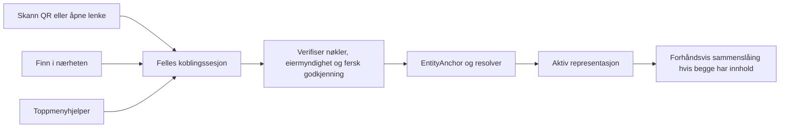

# Telefonen som trygg utvidelse av entiteten

Dato: 2026-09-10. Historisk beslutningsgrunnlag. Implementasjonsstatus, faktiske testresultater og gjenværende grenser per 11. september finnes i [personkoblingens prøveoppskrift](Personal_Entity_Link_Test_Runbook_2026-09-11.md). Nye datakontrakter nedenfor er fortsatt forslag for Kjetils vurdering.

Presisering 11. september: Det er menneskers entiteter som kobles. Scaffoldene er steder, mens administrator- og agentidentiteter har egne roller. Ny nærhetskode bruker en additiv `CellNearby`-pakke i draft CellProtocol PR38; selve toppmenyhjelperen er funnet i HavenAgentD og har fått inngang til personseremonien. Avsnittene nedenfor beskriver vurderingen før denne implementasjonen, ikke dagens leveransestatus.

## Anbefaling

Fullfør og verifiser den allerede mergede telefon → remote scaffold-flyten først. La QR, lenke og «Finn i nærheten» starte samme identitetskobling. Bygg ny Apple-transport med Network framework, og planlegg migrering av eksisterende Multipeer-kode. Toppmenyhjelperen bør gi en lett tilgjengelig inngang til kobling, status og tilbakekalling.

Telefonen skal kunne representere samme entitet i avtalt kontekst. Sammenslåing av to entiteter som begge har data, må i tillegg ha en gjennomgått plan for data, avtaler og konflikter. Bevis for kontroll over to nøkler er nødvendig, men gir ikke alene myndighet til å flytte alle data eller endre alle avtaler.

## Kildestatus og eksisterende beslutninger

Undersøkelsen omfatter lokale kilder, GitHub-status og utvalgte filer på `main`, samt Apples dokumentasjon. Dette er kildekontroll, ikke en kjørt sikkerhetssertifisering eller ende-til-ende-test.

Lokale HEAD-er ved lesing: Binding `775fc93d` på `codex/havenagentd-sentinel-remote-intent-icon-20260804`, CellProtocol `4096760` på `pdd/tillitspakke-agentflaate`, CellScaffold `1dbdee23`. Binding har eksisterende endringer fra annet arbeid. Lokale filer er derfor ikke lik dagens `main` eller installert app/server.

Det eksisterende [statusnotatet fra september](/Users/kjetil/Build/Digipomps/HAVEN/CellScaffold/Deliverables/PDD_entitetslenking-paa-tvers-av-scaffolds_2026-09-04/STATUS.md) registrerer at Kjetil godkjente kode + fersk autentisering på gammel side, full «samme entitet» og forhåndsvisning ved ikke-tomme lokale data. Dette forslaget viderefører den retningen.

| Del | Kontrollert evidens | Betydning |
| --- | --- | --- |
| Telefonens QR-flyt | [Binding #30](https://github.com/Digipomps/Binding/pull/30), merget 2026-09-09, `3c712731b4ace977b5bc0786d73b6158d392456a` | QR-skanning, lokalt signert forespørsel, fire kontrollord, lokal verifikasjon og fullføring finnes allerede. |
| Web og remote scaffold | [CellScaffold #223](https://github.com/Digipomps/CellScaffold/pull/223), merget 2026-09-09, `6b666b2f69a5c6ff83b2d7c1a3ca3bc36dd5c0d2` | Møteplass for koblingen, passkey-godkjenning og «Mine apparater» er merget. Merge-status kontrollert med `gh` etter at connectoren svarte 404. |
| Felles eierkobling | [CellProtocol #33](https://github.com/Digipomps/CellProtocol/pull/33), merget 2026-09-05, `c500672cc10eadbd30b6fea5e108da75a6e9a03a` | Register og resolverstøtte for `same_entity`, samt runtime-policy for ferskt autentiseringsbevis, finnes allerede. |
| Aktuell appkode | [IdentityLinkFlow.swift](https://github.com/Digipomps/Binding/blob/main/Binding/IdentityLinkFlow.swift), lest fra `main`, blob `11447156c6c39c4742140d17ae9cfb7ecfda172c` | Bruker VisionKit-skanner, `IdentityLinkSAS`, `IdentityLinkProtocolService` og lokal lagring av fullføringskonvolutt. |
| Aktuelle felles typer | [IdentityLinkCompletion.swift](https://github.com/Digipomps/CellProtocol/blob/main/Sources/CellBase/Identity/IdentityLinkCompletion.swift), blob `b34d0ddf12d1d9029ce795c9a4bf4e511f59111f`; [IdentityLinkRegistry.swift](https://github.com/Digipomps/CellProtocol/blob/main/Sources/CellBase/Identity/IdentityLinkRegistry.swift), blob `98440b14de62d0cec9ce81dd210d821e1aa2fc93` | Ikke opprett et nytt sett enrollment-typer, en ny kontrollordalgoritme eller et parallelt same-entity-register. |
| Nærhetsoppdagelse | Lokal [ScannerService.swift](/Users/kjetil/Build/Digipomps/HAVEN/CellProtocol/Sources/CellApple/EntityRadar/ScannerService.swift:57) og [scannerstatus 10. september](/Users/kjetil/Build/Digipomps/HAVEN/Binding/Documentation/NearbyScannerImplementation_2026-09-10.md) | CellApple har Multipeer og `BridgeTransportProtocol`-adapter. Den nye offentlige utdragsflyten er separat fra identitetskobling; valg av en person må ikke gi eiermyndighet. |
| Faktisk telefon/server | [Tidligere testresultat](/Users/kjetil/Build/Digipomps/HAVEN/CellScaffold/Deliverables/PDD_entitetslenking-paa-tvers-av-scaffolds_2026-09-04/TESTRESULT.md) og [akseptnotat](/Users/kjetil/Build/Digipomps/HAVEN/CellScaffold/Deliverables/PDD_entitetslenking-paa-tvers-av-scaffolds_2026-09-04/ACCEPT.md) | Dokumenterer fire macOS-tester, men ikke fysisk telefon → staging. Dagens utrulling og fullført brukerreise er ikke kontrollert her. |

Det lokale [BindingEntityScaffoldExtensionCell.acceptApproval](/Users/kjetil/Build/Digipomps/HAVEN/Binding/Cells/EntityScaffoldExtensionCell.swift:521) lagrer en aktiv koblingspost uten godkjennersignaturverifikasjon og rapporterer `signatureVerified=false`. Dette er en konkret begrensning i den undersøkte arbeidsgrenen, ikke et bevist hull i dagens utrulling. Filen finnes ikke i den undersøkte filtrevisjonen på GitHub `main`. Den må ikke brukes som grunnlag for den nye koblingsopplevelsen.

## Opplevelsen

Ett begrep i appen: **«Bruk entiteten min her»**. Under «Mine enheter og steder» vises telefon, Mac, agenter og remote scaffolds, med hvilken entitet/kontekst de representerer, tilgang og siste bekreftede status.

### Første telefon → remote scaffold

1. På innlogget web: «Koble til telefon». Vis en kortlivet QR og hvilken entitet/sted den gjelder.
2. I HAVEN: «Bruk entiteten min her» → «Skann kode». På samme telefon kan «Åpne i HAVEN» starte samme flyt via lenke.
3. Telefonen oppretter eller bruker sin aktuelle lokale nøkkel og signerer den konkrete koblingsforespørselen. Private nøkler blir i sine vaults.
4. Begge skjermer viser entitet, faktisk serverdomene og de samme kontrollordene. Brukeren godkjenner med passkey på siden som allerede har myndighet. Lokal Face ID/Touch ID brukes når en native eiernøkkel krever det; telefonens biometri kan ikke alene bevise kontroll over web-entiteten.
5. Vis «Kobler til …» inntil serveren har akseptert koblingen og telefonen har bekreftet lagring og relevant tilgang. Deretter «Du kan nå bruke entiteten din på denne telefonen».
6. Hvis telefonen allerede har data: vis «Du har også innhold her». Behold innholdet og åpne sammenslåingsforhåndsvisning. Ikke skjul eller overskriv det når identiteten kobles.

Gjenbruk septemberflytens GUI og fire kontrollord. Ikke innfør et nytt tallkodeformat uten en begrunnet, testet endring. Kontrollen gjelder hva man kobler til, ikke bare om en kryptografisk signatur finnes.

### Telefon → Mac eller lokal agent

Toppmenyen får «Koble til telefon». Dette åpner et avgrenset oppdagelsesvindu, foreslått to minutter, med QR som umiddelbart alternativ. Telefonens «Finn i nærheten» viser kandidater. Etter valg følger samme kontrollord og eiergodkjenning som over.

En agent kan transportere forespørselen og bruke avtalte fullmakter. At en agent er installert på Mac-en, eller allerede kan sende varsler, gjør den ikke automatisk til eier eller fri godkjenner. Gjenbruk eksisterende [AgentEntityLinkContract](/Users/kjetil/Build/Digipomps/HAVEN/Binding/HavenAgentD/Sources/HavenAgentRuntime/AgentEntityLinkContract.swift:29) der det er agentdelegering som skal uttrykkes; ikke likestill den med personens fulle `same_entity`-kobling.

Foreslått toppmenyinnhold: «Koble til telefon», «Venter på godkjenning», «Mine enheter og steder» og «Koble fra». Detaljert sammenslåing åpnes i HAVEN. Hjelperen skal bruke samme godkjennings- og nøkkelforvaltning som appen. Kildemappen til selve toppmenyhjelperen ble ikke identifisert; Kjetil er spurt om navn/mappe. Ansvarsdelingen kan vurderes uten den opplysningen.

## QR, nærhet og friksjon

| Situasjon | Anbefalt inngang | Begrunnelse / begrensning |
| --- | --- | --- |
| Telefon ved Mac med HAVEN/hjelper | «Finn i nærheten», QR synlig som alternativ | Kan spare kameraåpning og sikting. Krever oppdagelse, valg og nettverkstillatelse; førstegangsbruk kan derfor ta lengre tid enn QR. |
| Telefon og remote scaffold i nettleser | QR | Serveren er ikke en lokal radiomotpart. Nettleseren får ikke Multipeer-funksjonalitet bare fordi serveren bruker Swift. |
| Web og HAVEN på samme telefon | Lenke til appen | Ingen skanning av egen skjerm. Samme utløp, målvalidering og eiergodkjenning. |
| Flere ukjente enheter i nærheten | QR eller bevisst valg + kontrollord | Nærhet, navn og signalstyrke beviser ikke at enheten er din. |
| Kamera eller lokalt nettverk er utilgjengelig | Lenke eller manuelt oppgitt møteplasskode | Koden brukes bare til å finne en sesjon, med utløp og forsøksbegrensning. Den er ikke eierbevis. |
| Allerede godkjent enhet | Automatisk gjenoppretting av tillatt forbindelse | Ny vanlig nøkkelutfordring og sjekk av aktiv kobling; ingen ny innmelding for hvert nettverksbytte. |

**Mindre friksjon er en testbar hypotese, ikke målt resultat.** Nærhet fjerner ofte ett fysisk grep. Den viktigste varige forenklingen er at en godkjent kobling overlever omstart og transportbytte, med forståelig tilbakekalling.

Apple sier i [TN3213](https://developer.apple.com/documentation/technotes/tn3213-moving-from-multipeer-connectivity-to-network-framework) at Xcode 27 deprekerer hele Multipeer Connectivity og anbefaler Network framework. Network støtter også Apple peer-to-peer Wi-Fi; de eldre `NWBrowser`/`NWListener`/`NWConnection`-API-ene kan brukes for eldre OS-mål. Derfor anbefales Bonjour + Network for ny lokal adapter. Prosjektets undersøkte iOS-mål er 18.0; nyere API-er kan ikke gjøres obligatoriske uten et eget minimumsversjonsvalg.

Lokalt nett krever relevante tillatelser og Bonjour-deklarasjoner, også ved Multipeer. Be først når brukeren velger nærhetsfunksjonen. Se [Apple TN3179](https://developer.apple.com/documentation/technotes/tn3179-understanding-local-network-privacy). Multipeers dokumentasjon beskriver at bakgrunnsbruk stopper oppdagelse og bryter sesjoner; derfor er dette ingen alltid aktiv kanal til en låst iPhone. Se [Multipeer Connectivity](https://developer.apple.com/documentation/multipeerconnectivity). Bytte til Network opphever ikke iOS-livssyklusbegrensninger.

Den mergede skanneren bruker VisionKit. [Apple beskriver støtte- og tilgjengelighetssjekk](https://developer.apple.com/documentation/visionkit/scanning-data-with-the-camera); kameraavslag må gi en forståelig alternativ inngang. Verken QR eller nærhet skal kreve varslingstillatelse for å fullføre en kobling i forgrunnen.

## Sikkerhetskontrakten som begge innganger må bruke

Beskyttede handlinger er innmelding av en ny representerende identitet, tilgang til entitetens private celler, eventuell agentdelegering og senere datamigrering. Myndigheten følger den domeneavgrensede eieren eller en eksplisitt gyldig fullmakt, håndhevet av resolver/EntityAnchor.

- **Riktig motpart:** verifiser hvem som faktisk har myndighet for målentiteten, ikke bare at en medsendt offentlig nøkkel verifiserer en medsendt signatur. For web inngår den betrodde serverkonteksten og registrert passkey; for en ny lokal motpart inngår en verifisert nøkkelutveksling bundet til kontrollord/QR og eierbevis.
- **Riktig handling:** bind signaturene til forespørsel, begge relevante nøkkelidentiteter, målentitet, domene, formål, omfang og utløp. Verifierens forventninger kommer fra betrodd lokal sesjon/policy. Innkommende `expected*`-felt kan ikke definere sin egen tillit.
- **Fersk godkjenning:** kontroller faktisk passkey-/vault-bevis. Et felt som sier at Face ID er utført, er ikke tilstrekkelig. Dagens `IdentityLinkRuntimePolicy` må være riktig installert og håndhevet også ved direkte CellProtocol-kall.
- **Kryptert transport:** HTTPS/WSS remote; lokalt en autentisert kryptert kanal bundet til koblingsseremonien. Ingen «godta alle sertifikater»-gren. TLS-serverautentisering og HAVEN-eiermyndighet er to nødvendige, forskjellige kontroller.
- **Fullføring:** verifiser ny nøkkel med fersk utfordring; lagre kobling og brukt engangsbevis konsistent. Duplikatlevering skal enten gi samme verifiserte kvittering eller en tydelig avvisning, aldri nye rettigheter.
- **Gjenopptakelse:** brudd etter servergodkjenning, før lokal lagring eller mellom to bekreftelser må kunne avklares med autentisert status/kvittering. Ikke løs usikker status ved blind ny godkjenning.
- **Tilbakekalling:** sjekk aktiv kobling ved beskyttet bruk, og avklar hvordan eksisterende forbindelser mister tilgang. Vis forskjell på frakoblet, tilbakekalt og en offline motpart som ennå ikke har bekreftet tilbakekalling. Tilbakekalling kan ikke hente tilbake allerede mottatte data.
- **Personvern:** oppdagelse deler kortlivet, tilfeldig sesjonsinformasjon og protokollstøtte. Ingen stabile Entity-ID-er, kontaktdata eller private profiler i kringkasting. Koblingsbevis og offentlige kontaktutdrag holdes adskilt. Logger trenger hendelsestype og resultat, ikke QR-payload, passkey-assertions eller private data.

Disse kontrollene dokumenterer krav til integrasjonen. De er ikke en påstand om at alle mangler i dagens `main`. En ondsinnet server kan fortsatt skade data den selv forvalter; klientverifiserte signaturer og bevis gjør ikke all serverlagring uavhengig av servertillit.

## Hva bør ligge i CellProtocol?

| Område | Finnes / foreslås | Plassering og grense |
| --- | --- | --- |
| Enrollment og samme entitet | Finnes: request, approval, completion, kontrollord, register og runtime-policy | Gjenbruk CellBase, EntityAnchor og resolver. Ikke innfør et parallelt identitetssystem. |
| Felles sesjonsforløp | Foreslås: versjonert, transportuavhengig tilstand for opprettet, venter, godkjent, aktiverer, aktiv, avbrutt og utløpt | Delte kontrakter i CellBase, autorisert celle/runtime med persistens hos verten. Start med å sammenholde eksisterende rendezvous-kontrakt og scaffold-enrollment. Nye typenavn og keypaths avtales før implementasjon. |
| Transport | Finnes: `BridgeTransportProtocol`; foreslås lokal Network-adapter og en liten oppdagelsesgrense uten `MCPeerID` i felles kontrakt | Apple-adapter i CellApple. Serveradapter i CellVapor/CellScaffold. Transport gir kandidater og leverer meldinger, ikke rettigheter. |
| QR-lesing og lokal autentisering | QR finnes i Binding; eventuell gjenbrukbar kamerakomponent kan trekkes ut etter behov | Native Apple-lag. Produkttekst og flyt i Binding. Ingen ny Skeleton-elementtype er nødvendig for første leveranse. |
| Agent og toppmeny | Integrasjonsarbeid | HavenAgentD/hjelper for lokal sesjon og status. Bruk eksisterende signer/vault og cellehandlinger. Agentens fullmakter forblir eksplisitte. |
| Sammenslåing av innhold | Foreslås: gjennomgåbar merge-plan og signert commit-kontrakt, hvis eksisterende EntityAuthorityCommit ikke dekker behovet | Generelle typer/policy i CellProtocol, vertsavhengig lagring i EntityAnchor og migreringsvisning i appen. Separat vurdering av ny runtime-semantikk. |

## Når begge entitetene har innhold

Brukeren skal kunne se to entiteter, bevise myndighet over begge og ende med én forståelig samlet representasjon. Den interne modellen kan bevare gamle ankre og referanser slik at historikken fortsatt kan etterprøves.

Foreslått plan viser kilde og mål, hvilke data som beholdes/kopieres, mulige duplikater, motstridende felt og hvilke avtaler eller tilganger som ikke kan overføres automatisk. Begge eierautoritetene signerer samme versjonerte planhash, med referanser til tilstanden planen ble laget fra. Endres relevant tilstand før fullføring, må planen valideres på nytt. Organisasjons- eller fellesentiteter følger sin egen godkjenningspolicy; én nøkkel er ikke nødvendigvis tilstrekkelig.

Fullføring bør bruke autoriserte, idempotente operasjoner, kildeproveniens og eksplisitt konfliktpolicy per datafamilie. Historiske signaturer og avtaler omskrives ikke. Det opprettes nye koblinger/vedtak der det trengs. Rett til lagring eller replikering må være gitt, og skal ikke tolkes som rett til offentliggjøring. Dette bygger på eksisterende [EntityAuthorityCommit-notat](/Users/kjetil/Build/Digipomps/HAVEN/Binding/Documentation/EntityAuthorityCommit_v0_2026-07-15.md) og [arkitektur for entiteter på tvers av scaffolds](/Users/kjetil/Build/Digipomps/HAVEN/Binding/Documentation/CrossScaffoldPurposeEntityFabric_Architecture_2026-07-14.md).

Første sammenslåingsversjon bør bevare kildedata til resultatet er verifisert. «Koble fra» skal beskrive hvilke framtidige tilganger som fjernes; det må ikke presenteres som generell angreknapp for allerede utførte migreringer eller deling.

## Konkret leveranserekkefølge og aksept

1. **Integrer riktig revisjon og verifiser QR-løpet.** Bygg fra koordinert `main`/reviewet gren, bekreft tilsvarende serverversjon og runtime-policy. Koble én fysisk iPhone til riktig webentitet, les en privat prøveressurs som var avvist før, start begge sider på nytt, tilbakekall, og bekreft at beskyttet tilgang avvises. Test også når telefonen har eksisterende data. Behold felles same-entity-omfang slik septemberbeslutningen beskriver.
2. **Avklar robusthet og agentkobling.** Test avbrudd og omstart på hvert fullføringstrinn. Den undersøkte `main`-flyten lagrer etter serverfullføring og gjør lokal EntityAnchor-fullføring best effort; «ferdig» må svare til det produktet faktisk lover. Kontroller DeviceIngress mot sin egen nøkkel, domene, formål og registreringskonvolutt. Dagens [DeviceIngressRegistrationClient](https://github.com/Digipomps/Binding/blob/main/Binding/DeviceIngressRegistrationClient.swift) har en egen engangskonvolutt og scope `device-ingress.register`; ikke koble inn en generell same-entity-konvolutt uten å avklare kontraktene. Varsling skal være et separat, forståelig valg.
3. **Legg til nærhet og toppmeny.** Kjør samme godkjenningsforløp over lokal adapter, med QR tilgjengelig. Brukeren skal ikke velge transportprotokoll. Bevar eksisterende scanneratferd mens adapteren byttes ut.
4. **Implementer datamigrering etter vurdert kontrakt.** Begge eiersider, forhåndsvisning, konflikter, idempotens, avbrudd, replikater og tilbakekalling må være dekket før to ikke-tomme entiteter presenteres som ferdig slått sammen.

Negative tester for første leveranse: ugyldig/manglende signatur, feil godkjenner, selvkobling med samme nøkkel, feil mål/domene/challenge, utløpt billett, gjenbruk etter omstart, manglende fersk autentisering, direkte kall utenom web, avbrutt lokal lagring og tilbakekalt kobling i allerede åpen forbindelse. Ingen skal vise «koblet» etter en avvist eller uavklart operasjon.

Foreslått UX-prøve: fem brukere, QR og nærhet i byttet rekkefølge, både med nye og allerede gitte tillatelser. Registrer tid, antall handlinger, feilvalg og behov for hjelp. Foreløpig akseptmål: minst fire av fem fullfører uten veiledning innen 60 sekunder og kan forklare hvilken entitet/sted som fikk tilgang og hvordan den fjernes. Nærhet blir foretrukket inngang først hvis målingen viser lavere friksjon uten flere feilvalg. Dette er foreslåtte mål; ingen slike målinger er utført.

## Beslutnings- og evidenslogg

Formål: trygg egenkontroll over representasjon (`purpose://access.audit.privacy`) og forståelig brukerreise (`purpose://gui.quality.functional-accessible`), eksisterende referanser i [Book 23](/Users/kjetil/Build/Digipomps/HAVEN/CellProtocolDocuments/Book/23_Purpose_Knowledge_Base.md).

| Analyse-mål | Måling, baseline → mål | Frist og evidens | Sluttstatus |
| --- | --- | --- | --- |
| Avklare hva som allerede finnes | 0 → 3 kontrollerte relevante PR-statuser, pluss implementasjonsankre | Denne vurderingen; kildetabellen | Oppfylt |
| Levere vurderbart forslag | Uavklart → brukerflyt, transportvalg, ansvarsdeling, merge-grense og testkriterier dokumentert | Denne vurderingen; seksjonene over | Oppfylt |

| Påstand/forslag | Vurdering | Støtte og innvending |
| --- | --- | --- |
| QR-flyten må bygges fra grunnen | Avkreftet | Binding #30 og CellScaffold #223 er merget; lokal arbeidsgren var misvisende som mål på `main`. |
| Vi må lage same-entity-primitiver i CellProtocol | Avkreftet | CellProtocol #33 og undersøkte `main`-typer. Nye behov gjelder integrasjon og eventuelt felles livssyklus/merge-kontrakt. |
| MPC er rett grunnlag for ny nærhetskode | Frarådes | Apple TN3213. Motargument: eksisterende MPC-adapter reduserer kortsiktig arbeid; behold den som overgang der nødvendig. |
| Nærhet gir mindre friksjon enn QR | Åpen; eier: implementerende appteam/Kjetil | Plausibelt ved telefon/Mac. Tillatelser, flere kandidater og oppdagelsesfeil kan snu resultatet. Avgjøres med UX-prøven. |
| To nøkkelbevis er tilstrekkelig til å slå sammen alle data og rettigheter | Avkreftet som generell regel | Myndighet for begge mål, avtalebegrensninger og merge-policy må også være oppfylt. |
| Telefon → dagens server fungerer ende til ende | Åpen; eier: implementerende team/Kjetil | Merge er bekreftet. Utrulling, fysisk telefon, omstart og tilbakekalling må demonstreres. |
| Toppmenyen bør starte samme koblingssesjon | Anbefalt design, Kjetil vurderer | Gir synlig inngang på Mac og én felles verifikasjonsbane. Eksakt hjelpeprosjekt gjenstår å identifisere. |

Korrigeringer i analysen: «QR mangler» ble avgrenset til lokal arbeidsgren etter funn av septemberarbeidet, og «merge gjenstår» ble korrigert etter GitHub-oppslag. Det lokale signaturhullet står som en grenbegrensning, ikke produksjonsfunn. Ingen paneldelegasjon eller numerisk evidensscore er brukt.

Metodediagnostikk Q1–Q10: Q1 de to endrede hovedkonklusjonene har nye kildeankre; Q2 fire av sju vurderte påstander avviser eller begrenser et mulig løsningspremiss; Q3 alle faktiske lukkede påstander har navngitt hentet kilde; Q4 anbefalingen er knyttet til brukerens friksjonsmål og er merket som anbefaling; Q5 UX-hypotesen har et eksplisitt negativt utfall; Q6 ingen ny sammenlignende UX-prøve; Q7 ingen motivpåstander; Q8 alle sju påstander er vurdert eller åpne med eier; Q9 eksisterende MPC-kode er konkret støtte for å bevare overgangsadapteren; Q10 ingen konklusjonsendring uten ny kilde. Dette er metodestatus, ikke målt produktsikkerhet.

Åpent for Kjetils vurdering: Network-basert nærhetsinngang, felles gjenopptakbar koblingssesjon, toppmenyens rolle og separat merge-plan/commit for innhold. Septemberbeslutningen om samme entitet brukes som eksisterende grunnlag. Arkitekturvurderingen er levert; funksjonell godkjenning av app/server er ikke utført.
